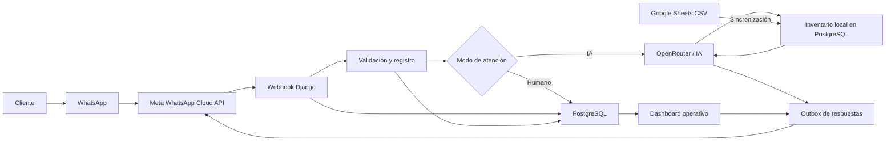

# Arquitectura del proyecto

Revisión documental: 2026-11-07. Describe el código actual, no certifica el estado de producción. Para instalación consulta [README.md](README.md); para configuración y estructura técnica, [contexto.md](contexto.md).

## Datos relevantes para mostrar:

- **Problema que resuelve:** automatiza la atención de clientes por WhatsApp y chat web.
- **Canales disponibles:** WhatsApp mediante Meta Cloud API y chat web.
- **Funciones principales:**
  - Respuestas automáticas con IA.
  - Consulta de productos, precios y stock.
  - Soporte para mensajes de texto e imágenes.
  - Identificación visual de productos.
  - Atención manual mediante cambio a modo humano.
  - Historial de conversaciones.
  - Dashboard para gestionar contactos y mensajes.
- **Inventario:** se administra desde Google Sheets y se sincroniza a PostgreSQL; las consultas buscan textualmente en ese catálogo local, sin embeddings.
- **Integraciones:** Meta WhatsApp Cloud API, Google Sheets, OpenRouter y PostgreSQL.
- **Seguridad:**
  - Validación de firmas de Meta.
  - Control de usuarios y roles.
  - Protección de credenciales mediante variables de entorno.
  - No se almacenan permanentemente las imágenes recibidas.
- **Flujo de atención:**

```text
Cliente -> WhatsApp -> IA -> Inventario -> Respuesta
                         |
                         -> Operador humano
```

- **Estado operativo:** la cantidad de productos y el funcionamiento de las integraciones deben comprobarse en cada despliegue; no son cifras ni resultados garantizados por este documento.
- **Escalabilidad:** permite agregar más productos, usuarios y conversaciones.
- **Limitaciones que conviene aclarar:**
  - El dashboard todavía es básico.
  - Las respuestas dependen de Meta, OpenRouter y el catálogo local; actualizar el catálogo depende de Google Sheets.
  - Se recomienda configurar correctamente HTTPS, copias de seguridad, monitoreo y rotación de credenciales antes de producción.

También llevaría una demostración práctica:

1. Cliente pregunta por un producto.
2. El bot consulta precio y disponibilidad.
3. Cliente envía una imagen.
4. El sistema busca coincidencias reales en el inventario.
5. El operador toma el control desde el modo humano.
6. Se muestra cómo actualizar el stock desde Google Sheets.

La cifra más importante para el cliente no es cuántas líneas de código tiene, sino cuánto puede **reducir tiempos de respuesta, automatizar consultas y facilitar la gestión de ventas o soporte**.

## Flujo desde el cliente

1. **Cliente:** envía un mensaje o imagen por WhatsApp.
2. **Meta WhatsApp:** recibe el mensaje y lo envía al webhook del sistema.
3. **Sistema:** valida y registra el mensaje.
4. **IA:** interpreta la consulta del cliente.
5. **Inventario:** consulta productos, precios y stock del catálogo local previamente sincronizado desde Google Sheets.
6. **IA:** genera una respuesta utilizando la información encontrada.
7. **Sistema:** envía la respuesta al cliente mediante WhatsApp.
8. **Operador humano:** puede intervenir cuando sea necesario, cambiando la conversación de modo IA a modo humano.

### Flujo resumido

```text
Cliente
  ↓
WhatsApp / Meta Cloud API
  ↓
Sistema y webhook
  ↓
IA interpreta la consulta
  ↓
Inventario local sincronizado desde Google Sheets
  ↓
IA genera la respuesta
  ↓
WhatsApp envía la respuesta
  ↓
Cliente
```

### Intervención humana

```text
Cliente
  ↓
WhatsApp
  ↓
Sistema
  ↓
Operador humano
  ↓
Respuesta al cliente
```

## Arquitectura realizada

El proyecto utiliza una arquitectura web modular basada en **Django**:

### Diagrama de arquitectura



```text
Cliente
  ↓
WhatsApp / Meta Cloud API
  ↓
Webhook Django
  ↓
Validación y registro del mensaje
  ↓
Procesamiento de IA mediante OpenRouter
  ↓
Consulta del inventario local en PostgreSQL
  ↓
Generación de respuesta
  ↓
Cola Outbox
  ↓
Meta WhatsApp Cloud API
  ↓
Cliente
```

### Componentes principales

- **Django:** framework principal de la aplicación.
- **Python y frontend:** Python 3.10+, Django 6.1.3 y plantillas con Tailwind Play CDN, sin proceso de compilación frontend.
- **PostgreSQL:** almacenamiento de usuarios, conversaciones, mensajes, contactos y estados.
- **Meta WhatsApp Cloud API:** recepción y envío de mensajes.
- **Webhook:** punto de entrada para mensajes de WhatsApp.
- **OpenRouter:** proveedor de inteligencia artificial.
- **Google Sheets:** fuente actualizada de productos, precios y stock.
- **Dashboard operativo:** gestión de conversaciones y cambio entre atención automática y humana.
- **Sistema Outbox:** conserva las respuestas antes de enviarlas y permite reintentos.
- **Sistema de usuarios y roles:** controla el acceso al dashboard y a las funciones administrativas.

### Procesamiento y límites operativos

- El chat web es público; sus conversaciones se protegen por usuario o por sesión anónima. El panel de WhatsApp requiere ser superusuario, administrador o empleado.
- El webhook valida la firma sobre el cuerpo original, procesa entradas con `force=True` (sin esperar la agrupación habitual) y envía la cola de salida en la misma petición.
- El envío manual del panel solo crea una salida en `Outbox`; no llama a Meta. Necesita que el worker o un nuevo mensaje entrante ejecute `process_outbox()`.
- `whatsapp_worker --once` no es una simulación: intenta sincronizar el inventario y procesa y envía mensajes reales. En ejecución continua consulta las colas cada dos segundos y sincroniza cada `INVENTORY_SYNC_MINUTES`.
- La sincronización actualiza los productos por SKU en una transacción y desactiva los ausentes sin borrarlos; los identificadores se conservan.
- El reconocimiento de imágenes de WhatsApp requiere un modelo multimodal en OpenRouter. Identificar visualmente un producto no implica que esté disponible: las respuestas se limitan a coincidencias reales del catálogo.
- El blog, DummyJSON y el código vectorial se eliminaron: la única fuente es la hoja de Google. La migración `0013_remove_legacy_models` borra las tablas heredadas (`ProductDocument`, `Combo`); PostgreSQL ya no necesita pgvector (en bases existentes la extensión puede quedar instalada sin efecto).

## Buenas prácticas consideradas

- Separación del sistema por módulos: usuarios, chat, inventario y WhatsApp.
- Uso de variables de entorno para claves, contraseñas y configuraciones sensibles.
- Validación del token y de la firma `X-Hub-Signature-256` enviada por Meta.
- Verificación del `phone_number_id` para aceptar únicamente mensajes válidos.
- Prevención de mensajes duplicados mediante un `message_id` único.
- Control de estados de los mensajes: pendiente, procesando, procesado y fallido.
- Registro de errores mediante logs sin exponer credenciales ni información sensible.
- Limitación del tamaño de mensajes e imágenes recibidas.
- Eliminación de las imágenes después de su procesamiento, sin almacenamiento permanente.
- Validación del inventario antes de reemplazar la información anterior.
- Conservación del inventario anterior si falla la descarga o validación de Google Sheets.
- Control de permisos mediante roles de usuario.
- Separación entre atención automática y atención humana.
- Uso de transacciones de base de datos para evitar inconsistencias.
- Sistema de reintentos para mensajes que no pudieron enviarse.
- Uso de HTTPS para la comunicación pública con Meta.
- Pruebas mediante `manage.py test` y verificación de configuración con `manage.py check`.

Como mejora para una siguiente etapa, se recomienda incorporar una cola de procesamiento supervisada para que el webhook no dependa directamente del tiempo de respuesta de OpenRouter y Meta. Google Sheets se consulta durante la sincronización, no en cada búsqueda del catálogo.
