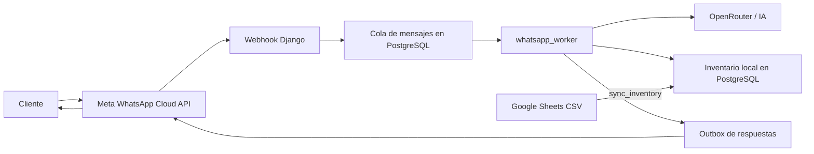

# Arquitectura del proyecto

Revisión documental: 2026-11-17. Describe el código actual, no certifica el estado de producción. Para instalación consulta [README.md](README.md); para el detalle técnico, [docs/arquitectura.md](docs/arquitectura.md); para el flujo paso a paso, [comofunciona.md](comofunciona.md).

## Resumen

- **Problema que resuelve:** automatiza la atención de clientes por WhatsApp.
- **Canal:** WhatsApp mediante Meta Cloud API. No hay chat web; sí un panel de operadores en `/whatsapp/`.
- **Funciones principales:**
  - Respuestas automáticas con IA.
  - Consulta de productos, precios y stock.
  - Soporte para mensajes de texto e imágenes.
  - Identificación visual de productos.
  - Historial por contacto, que permite recordar el producto elegido.
  - Panel de operadores: conversaciones, estado de cada envío, salud del sistema, modo humano y envío manual.
- **Inventario:** se administra desde Google Sheets y se sincroniza a PostgreSQL con `sync_inventory`; las consultas buscan textualmente en ese catálogo local, sin embeddings.
- **Integraciones:** Meta WhatsApp Cloud API, Google Sheets, OpenRouter y PostgreSQL.
- **Seguridad:**
  - Validación de firmas de Meta.
  - Control de usuarios y roles.
  - Protección de credenciales mediante variables de entorno.
  - No se almacenan permanentemente las imágenes recibidas.
- **Estado operativo:** la cantidad de productos y el funcionamiento de las integraciones deben comprobarse en cada despliegue; no son cifras ni resultados garantizados por este documento.
- **Limitaciones que conviene aclarar:**
  - Un mensaje manual solo se encola; el worker debe estar activo para enviarlo. Meta limita el texto libre a 24 h tras el último mensaje del cliente.
  - Las respuestas dependen de Meta, OpenRouter y el catálogo local; actualizar el catálogo depende de Google Sheets y del comando manual.
  - Se recomienda configurar correctamente HTTPS, copias de seguridad, monitoreo y rotación de credenciales antes de producción.

## Flujo desde el cliente

1. **Cliente:** envía un mensaje o imagen por WhatsApp.
2. **Meta WhatsApp:** recibe el mensaje y lo envía al webhook del sistema.
3. **Sistema:** valida la firma y registra el mensaje en una cola.
4. **Worker:** toma los mensajes pendientes, consulta el catálogo local y pide a la IA qué campos mostrar.
5. **Sistema:** redacta la respuesta con los valores reales del inventario y la guarda en el `Outbox`.
6. **Worker:** envía la respuesta al cliente mediante Meta, con reintentos.

```text
Cliente ─► WhatsApp / Meta ─► Webhook (firma HMAC) ─► Cola (PostgreSQL)
                                                         │
                                                         ▼
Cliente ◄─ WhatsApp / Meta ◄─ Outbox ◄─ Respuesta ◄─ Worker + IA + Inventario local
```

## Arquitectura realizada

El proyecto utiliza una arquitectura web modular basada en **Django**.



### Componentes principales

- **Django:** framework principal de la aplicación (`core`, `whatsapp`, `users`, `home`).
- **PostgreSQL:** usuarios, catálogo, contactos, mensajes, colas, límites y latidos del worker.
- **Meta WhatsApp Cloud API:** recepción y envío de mensajes.
- **Webhook:** `/whatsapp/webhook/`, único punto de entrada de WhatsApp.
- **Worker `whatsapp_worker`:** proceso independiente y obligatorio para responder.
- **OpenRouter:** proveedor de inteligencia artificial.
- **Google Sheets:** fuente de productos, precios y stock.
- **Outbox:** conserva las respuestas antes de enviarlas y permite reintentos.
- **Panel de operadores:** `/whatsapp/`, con modo humano y envío manual (superusuario, administrador o empleado).
- **Usuarios y roles:** acceso al admin de Django y al panel.

### Procesamiento y límites operativos

- El webhook valida la firma sobre el cuerpo original, guarda el mensaje y responde 200. No llama a la IA, no descarga imágenes y no envía nada.
- `whatsapp_worker --once` no es una simulación: procesa y envía mensajes reales. En ejecución continua consulta las colas cada dos segundos. No sincroniza el inventario.
- La sincronización actualiza los productos por SKU en una transacción y desactiva los ausentes sin borrarlos; los identificadores se conservan.
- El reconocimiento de imágenes requiere un modelo multimodal en OpenRouter. Identificar visualmente un producto no implica que esté disponible: las respuestas se limitan a coincidencias reales del catálogo.
- El blog, DummyJSON y el código vectorial se eliminaron: la única fuente es la hoja de Google. Las migraciones se reiniciaron (`core`, `users` y `whatsapp` con `0001_initial`).

## Buenas prácticas consideradas

- Separación del sistema por módulos: usuarios, motor de catálogo (`core`) y WhatsApp.
- Uso de variables de entorno para claves, contraseñas y configuraciones sensibles.
- Validación del token y de la firma `X-Hub-Signature-256` enviada por Meta.
- Verificación del `phone_number_id` para aceptar únicamente mensajes válidos.
- Prevención de mensajes duplicados mediante un `message_id` único.
- Control de estados de los mensajes: pendiente, procesando, procesado y fallido.
- Registro de errores mediante logs sin exponer credenciales ni teléfonos completos.
- Limitación del tamaño de mensajes e imágenes recibidas.
- Imágenes solo en memoria, sin almacenamiento permanente.
- Validación del inventario antes de reemplazar la información anterior; si falla la descarga o la validación, se conserva el catálogo anterior.
- Control de permisos mediante roles de usuario.
- Transacciones de base de datos para evitar inconsistencias.
- Reintentos con espera creciente para mensajes que no pudieron enviarse.
- HTTPS para la comunicación pública con Meta.
- Pruebas mediante `manage.py test` y verificación con `manage.py check`.

Google Sheets se consulta durante la sincronización, no en cada búsqueda del catálogo.
